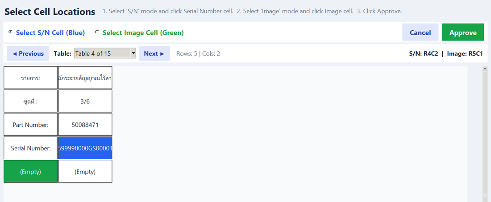

# ATP Image Injector

> Automatically insert device photos into Unit Test Word documents by matching Serial Number folders.


## Overview

This tool automates the process of inserting device photos into Unit Test Word documents (`.docx`). Instead of manually copying and pasting hundreds of images, simply organize your photos into Serial Number folders and let the app do the rest.

### Key Features

- **Dynamic Table Layout** — Automatically read the Word document so you can visually select where the S/N and Image cells are. No hardcoded formats!
- **Auto-match by Serial Number** — Folders named by S/N (e.g., `WZP301w123/`) are matched to the corresponding table in the Word document
- **HEIC Support** — iPhone `.heic` photos are automatically converted to JPG
- **Customizable Keyword** — Change the folder prefix from `WZP` to any keyword to match your project
- **Stop Button** — Cancel processing at any time; partial progress is saved
- **Portable** — Standalone `.exe` file, no Python installation required
- **Dark Theme UI** — Modern, clean interface with progress tracking and color-coded logs

## Quick Start

### Option 1: Run with Python (Recommended for v1.5.0+)
 
Since v1.4.0 the Smart Rotate / MAC scanner OCR runs on **[OpenThai2.0-OCR-Text](https://huggingface.co/iapp/OpenThai2.0-OCR-Text)** — a ~4 MB Thai + English OCR model that runs on the **CPU only** (no GPU, no PyTorch). Setup is now a small download instead of 3 GB. The model files ship in `models/OpenThai2.0-OCR-Text/` and are re-downloaded from Hugging Face automatically if missing.

**For Windows:**
1. Double-click `setup_windows.bat` to install dependencies and create a local virtual environment. (You only need to do this once).
2. Double-click `run_windows.bat` to launch the app!

**For macOS:**
1. Double-click `setup_mac.command` to install dependencies and create a local virtual environment. (You only need to do this once).
2. Double-click `run_mac.command` to launch the app!

For a massive EXE file download https://drive.google.com/file/d/1DP1b5245Kz_tljlczBh7rCKrCpvGjelG/view?usp=sharing


### Option 2: Run the .exe (Legacy / EXIF-only)

1. Download `Unit_Test_Image_Injector_v1.2.1.exe` from the [Releases](../../releases) page
2. Double-click to run (Contains EXIF rotation but NO Smart OCR rotation)
3. Select your files and click **▶ Run Injection**

### Option 3: Run from Python Manually (Command Line)

```bash
# Create and activate a virtual environment
python -m venv venv
source venv/bin/activate  # Or `venv\Scripts\activate` on Windows

# Install dependencies
pip install -r requirements.txt

# Run the app
python app.py
```

## How to Use

### Step 1: Prepare Your Folder Structure

Organize device photos into folders named by Serial Number:

```
Photo_Root/
├── WZP301000/
│   └── WZP301000/
│       ├── IMG_8402.JPG
│       ├── IMG_8403.JPG
│       └── 20260526_071125063_iOS.heic    ← auto-converted
├── WZP308888/
│   └── WZP308888/
│       ├── IMG_8410.JPG
│       └── IMG_8411.JPG
└── WZP3914ZNNN/
    └── ...
```

### Step 2: Launch the App


### Step 3: Configure

| Field | Description |
|-------|-------------|
| **📝 Word Document** | Select your Unit Test `.docx` template. **A pop-up will appear** letting you visually select the S/N cell and Image cell. |
| **⚙️ Configure Layout** | Click this to re-open the table grid layout and change your selected cell mappings. |
| **📁 SN Folders Directory** | Select the parent folder containing all `WZP*` subfolders |
| **Keyword** | Folder prefix to match (default: `WZP`, change as needed) |
| **💾 Output File** | Where to save the result (default: `unit_test_with_images.docx`) |
| **Auto-Rotate (EXIF)** | Check to use the basic camera orientation data. |
| **Smart Rotate (OpenThai OCR · CPU)** | **Highly recommended.** Reads the text in each photo with OpenThai2.0-OCR-Text and rotates it 90°/180°/270° so it reads left-to-right. Required if you take sideways photos of wide devices (like IP Phones). |

### Step 4: Run

Click **▶ Run Injection** and watch the progress:

- 🟢 `[OK  ]` — Image inserted successfully
- 🔵 `[SKIP]` — No matching table found in the document
- 🔴 `[ERR ]` — Error inserting image
- 🟡 `[CANCELLED]` — Stopped by user (partial save)

### Step 5: Stop (Optional)

Click **■ Stop** at any time to cancel. Any images already inserted will be saved to the output file.

## How to Configure Table Layout

The app natively parses the first table in your Word document and displays it in a grid. This allows you to visually map exactly where the Serial Number and Image insertion cells are. No more hardcoded layouts!



### Step-by-Step Guide:
1. **Select Document:** Click "Browse" next to **Word Document (.docx)**. Once you pick your template, the "Configure Table Layout" pop-up will appear automatically.
2. **Select S/N Cell:** Make sure the **Select S/N Cell (Blue)** option is checked. Click the cell in the grid that contains your Serial Number format (e.g., `WZP301...`). The cell will highlight in **Blue**.
3. **Select Image Cell:** Switch to the **Select Image Cell (Green)** option. Click the empty cell where you want the photos to be injected. The cell will highlight in **Green**.
4. **Approve:** Click the **Approve** button.
5. **Verify:** Back on the main screen, you will see a layout summary (e.g., `Layout: S/N at R6C4 | Image at R13C1`) confirming your configuration.

> **Tip:** If you ever need to change the mapping, you can click the **⚙ Configure Layout** button on the main app screen to reopen the visual grid.

## Supported Image Formats

| Format | Extension | Notes |
|--------|-----------|-------|
| JPEG | `.jpg`, `.jpeg` | Standard |
| PNG | `.png` | Standard |
| BMP | `.bmp` | Standard |
| TIFF | `.tiff`, `.tif` | Standard |
| HEIC | `.heic`, `.heif` | Auto-converted to JPG (iPhone photos) |

## Building from Source

### Build the .exe yourself

```bash
# Install PyInstaller
pip install pyinstaller

# Build standalone executable
python -m PyInstaller --noconfirm --onefile --windowed --name "Unit_Test_Image_Injector" app.py
```

The `.exe` will be created at `dist/Unit_Test_Image_Injector.exe`

## Requirements

### For running from Python:
- Python 3.10+
- `requirements.txt` installs the following automatically:
  - `python-docx` — Word document manipulation
  - `Pillow` — Image processing
  - `pillow-heif` — HEIC/HEIF support
  - `onnxruntime`, `opencv-python-headless`, `pyclipper` — OpenThai2.0-OCR-Text runtime
  - `huggingface_hub` — auto-downloads the model if `models/` is missing
  - `numpy` & `openpyxl`

### OCR engine configuration

| Setting | Default | Description |
|---------|---------|-------------|
| `OCR_BACKEND` env var | `openthai` | `openthai` = OpenThai2.0-OCR-Text (CPU). `easyocr` = legacy engine (`pip install easyocr`). |
| `OPENTHAI_OCR_DIR` env var | `models/OpenThai2.0-OCR-Text` | Use a model folder elsewhere. |
| `pip install openvino` | not installed | Optional — the runtime uses OpenVINO automatically when present (faster on Intel CPUs), otherwise ONNX Runtime. |

All OCR goes through [`ocr_engine.py`](ocr_engine.py) (`get_engine()`, `detect_orientation()`), used by both `app.py` and `mac_scanner.py`.

### For running the .exe:
- Windows 10/11
- No additional dependencies

## Bug Reports Resolved (v1.3.1)

If you were experiencing bugs in earlier v1.3.0/v1.2.x releases, these have now been officially resolved:
- **"The picture can't be displayed" in Word**: We identified that rotating an image stripped its Dots-Per-Inch (DPI) metadata. MS Word assumes an image with no DPI is infinitely large and crashes its image viewer. The script now aggressively forces `dpi=(72, 72)` upon injection.
- **HEIC Photos injecting sideways despite Auto-Rotate**: Converting `.heic` photos internally stripped the EXIF rotation tag before the AI or EXIF rotators could see it. We now enforce `exif_transpose` on HEIC files before saving the temporary conversion.
- **EasyOCR Silently Failing**: Previously, `easyocr` wasn't bundled. We have updated `run.bat` to perform an initial `pip install` download of the 3GB Machine Learning libraries so the GPU rotation functions correctly natively.

## Changelog

### v1.5.0 (Current)
- 📑 **Starting Table / Page Selection** — Choose which table index (1-based) to start injecting from, skipping cover/revision/summary tables automatically.
- 🧭 **Multi-Table Layout Picker** — Navigate across any table in the `.docx` (`◀ Previous`, `Next ▶`, or `Table X of N` dropdown) inside **Configure Table Layout** to map S/N and Image cells.
- 🏷 **Auto Device Model Detection & Filter** — Automatically detects device models across Cisco, Huawei, and TP-Link documents/folders (including `Part Number` ➔ `Description` summary mapping) with a multi-select checklist in the GUI.
- 🛡 **Adversarial Hardening & 100-Test Suite** — Boundary clamping, camera-subfolder exclusion (`DCIM`, `100APPLE`), and 100 unit/GUI/E2E tests.

### v1.4.0
- 🧠 **New OCR engine: [OpenThai2.0-OCR-Text](https://huggingface.co/iapp/OpenThai2.0-OCR-Text)** (iApp, Apache-2.0) replaces EasyOCR — Thai + English, CPU-only, ~4 MB model instead of ~3 GB of PyTorch.
- ⚡ **Faster Smart Rotate** — ~0.3–0.7 s per photo on CPU; the engine detects sideways text itself, so only 2 OCR passes per photo instead of 4.
- 🔌 **Pluggable backend** — new `ocr_engine.py`; `OCR_BACKEND=easyocr` keeps the old engine available.
- 🔎 **MAC scanner v3.0** — `mac_scanner.py` uses the same engine and also considers low-confidence lines (LCD text).

### v1.3.2
- 🚀 **Universal Document Support** — AI rotation now handles generic documents by dynamically scoring text density rather than strictly searching for rigid keywords.
- 📦 **Automated Native Setup** — Introduced `setup_windows.bat` and `setup_mac.command` scripts alongside `requirements.txt` to eliminate the need for downloading a 3GB executable.
- 🐛 **HEIC Skipping Bug Fix** — Repaired logic flaw where HEIC files were skipping internal format conversion loops.

### v1.3.1
- 🐛 **MS Word DPI Corruption Fix** — Fixed the infamous "picture can't be displayed" Red X bug.
- 🐛 **HEIC EXIF Bug Fix** — Fixed bug where HEIC conversion accidentally stripped EXIF rotation data.
- ⚡ **Auto-Installer & Defaults** — Auto-installer improvements; "Smart Rotate" enabled by default.

### v1.3.0 (Beta)
- 🧠 **Smart Auto-Rotate (EasyOCR)** — Uses PyTorch and your GPU to detect the exact orientation of text on screens and forcefully rotates the image 90°, 180°, or 270° until perfectly readable.

### v1.2.1 (Beta)
- 📸 **EXIF Auto-Rotate** — Automatically normalizes image orientations using EXIF data so they are upright in the document.

### v1.2.0 (Stable)
- ✨ **Dynamic Table Layout** — Automatically reads the Word document so you can visually select where the S/N and Image cells are. No hardcoded formats!
- ♻️ **Major UI Overhaul** — Added pop-up grid preview for selecting exact cell coordinates.

### v1.1.1
- 🐛 **Fixed empty keyword guard** — Empty keyword no longer matches all folders
- 🐛 **Removed hardcoded auto-detect paths** — User always browses for files (portable)
- 🐛 **Log output optimized** — Large folder sets (600+) show summary instead of flooding log
- ✅ **Multi-keyword support verified** — Works with `WZP`, `FVH`, or any custom prefix

### v1.1.0
- ✅ **Customizable keyword** — Change folder prefix from `WZP` to any string
- ✅ **Stop button** — Cancel processing with partial save
- ✅ **Version display** — Shown in title bar
- ✅ **Improved cancel handling** — Yellow-colored cancel messages in log

### v1.0.0
- ✅ Initial release
- ✅ Serial Number folder matching
- ✅ HEIC auto-conversion
- ✅ Dark theme GUI
- ✅ Progress bar and color-coded log
- ✅ Standalone .exe support

## License

MIT License — feel free to use and modify.
