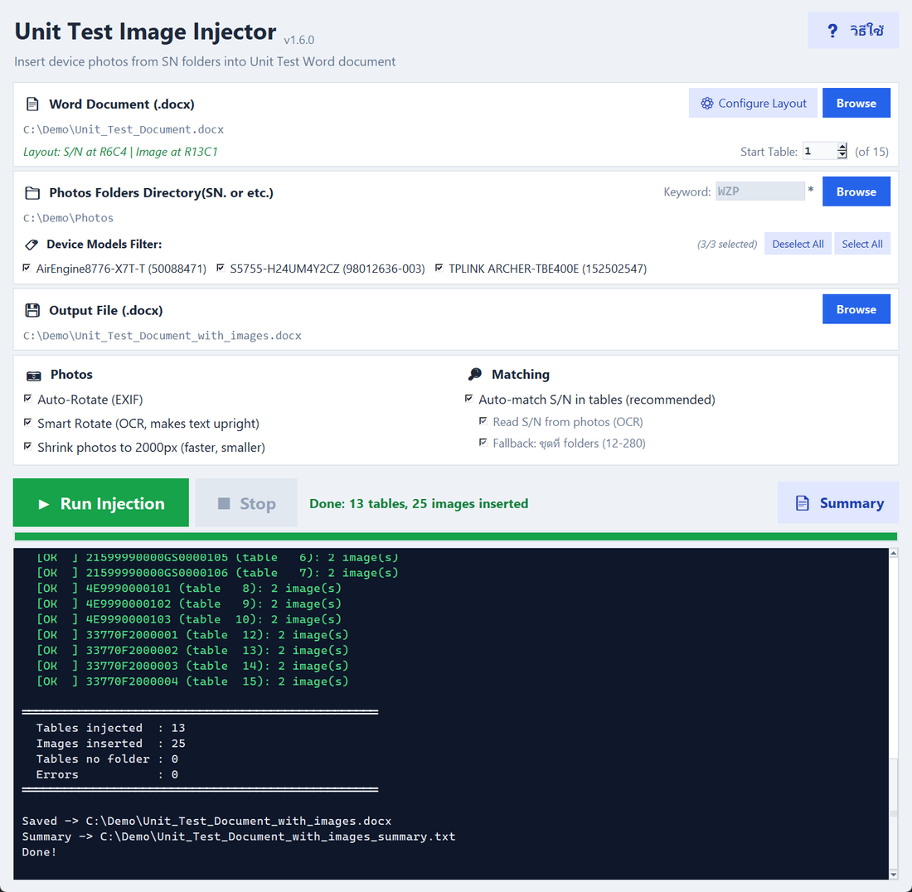
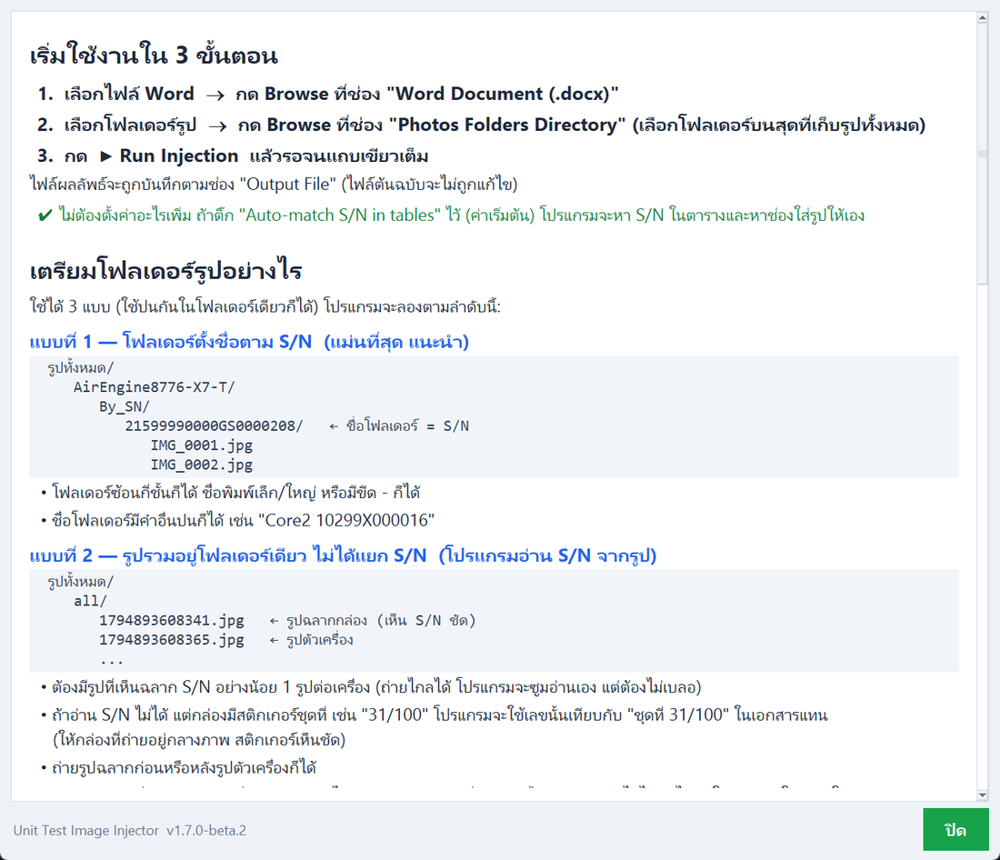

# ATP Image Injector

> Automatically insert device photos into Unit Test Word documents by matching Serial Number folders.


## Overview

This tool automates the process of inserting device photos into Unit Test Word documents (`.docx`). Instead of manually copying and pasting hundreds of images, simply organize your photos into Serial Number folders and let the app do the rest.

### Key Features

- **Verify Photos (beta, v1.7.0-beta.4)** — Optional: OCR every photo in the S/N and set-number folders and put a photo left in the wrong folder into the right table (Word output only, files on disk are not moved). Available as a [pre-release](../../releases); v1.6.2 is the stable version
- **Auto Mode (new in v1.6.0)** — Finds the Serial Number anywhere in each table and picks the photo cell by itself. No keyword or layout setup, and it works with different table layouts in the same document
- **Read S/N from Photos (OCR)** — Photos don't even need S/N folders: drop them into one folder and the app reads the S/N on each box label and groups the photos per device
- **Dynamic Table Layout** — Automatically read the Word document so you can visually select where the S/N and Image cells are. No hardcoded formats!
- **Auto-match by Serial Number** — Folders named by S/N (e.g., `WZP301w123/`) are matched to the corresponding table in the Word document
- **HEIC Support** — iPhone `.heic` photos are automatically converted to JPG
- **Customizable Keyword** — Change the folder prefix from `WZP` to any keyword to match your project
- **Stop Button** — Cancel processing at any time; partial progress is saved
- **Portable** — Standalone `.exe` file, no Python installation required
- **Clean, Easy UI** — Light theme with one meaning per colour, sharp on high-DPI screens, color-coded log, built-in Thai guide (❓ วิธีใช้)

## Quick Start

### Option 1: Windows .exe (easiest, no install)

1. Download **`Unit_Test_Image_Injector_v1.6.2.exe`** from the [latest release](../../releases/latest) (~148 MB; OCR model included, no Python needed).
2. Double-click to run. Windows SmartScreen may ask once: *More info → Run anyway*.
3. Pick the Word document and the photo folder, then click **▶ Run Injection**. Click **❓ วิธีใช้** for the Thai guide.

### Option 2: Run with Python
 
Since v1.4.0 the Smart Rotate / MAC scanner OCR runs on **[OpenThai2.0-OCR-Text](https://huggingface.co/iapp/OpenThai2.0-OCR-Text)** — a ~4 MB Thai + English OCR model that runs on the **CPU only** (no GPU, no PyTorch). Setup is now a small download instead of 3 GB. The model files ship in `models/OpenThai2.0-OCR-Text/` and are re-downloaded from Hugging Face automatically if missing.

**For Windows:**
1. Double-click `setup_windows.bat` to install dependencies and create a local virtual environment. (You only need to do this once).
2. Double-click `run_windows.bat` to launch the app!

**For macOS:**
1. Double-click `setup_mac.command` to install dependencies and create a local virtual environment. (You only need to do this once).
2. Double-click `run_mac.command` to launch the app!

Older builds (e.g. the legacy v1.2.1 EXIF-only exe) remain on the [Releases](../../releases) page.

### Option 3: Run from Python Manually (Command Line)

```bash
# Create and activate a virtual environment
python -m venv venv
source venv/bin/activate  # Or `venv\Scripts\activate` on Windows

# Install dependencies
pip install -r requirements.txt

# Run the app
python app.py
```

## How to Use

### Step 1: Prepare Your Folder Structure

Organize device photos into folders named by Serial Number:

```
Photo_Root/
├── WZP301000/
│   └── WZP301000/
│       ├── IMG_8402.JPG
│       ├── IMG_8403.JPG
│       └── 20260526_071125063_iOS.heic    ← auto-converted
├── WZP308888/
│   └── WZP308888/
│       ├── IMG_8410.JPG
│       └── IMG_8411.JPG
└── WZP3914ZNNN/
    └── ...
```

Since v1.6.0 **Auto mode** also accepts these layouts:

```
Photo_Root/                                  Photo_Root/
└── AirEngine8776-X7-T/                      ├── 1794893608341.jpg   ← box label (S/N readable)
    ├── By_SN/                               ├── 1794893608365.jpg   ← device photo
    │   ├── 21599990000GS0000208/            ├── 1794893608409.jpg   ← next box label
    │   │   ├── IMG_0001.jpg                 └── ...
    │   │   └── IMG_0002.jpg
    │   └── ...                              (no S/N folders: S/N is read by OCR,
    └── By_Number/195-280/  ← ignored         see "Auto Mode" below)
```

### Step 2: Launch the App



*Main window after a run (demo data). Green = run / success, red = stop / errors, blue = buttons / selection, amber = warnings.*

Click **❓ วิธีใช้** (top right) for the built-in Thai usage guide:



### Step 3: Configure

| Field | Description |
|-------|-------------|
| **📄 Word Document** | Select your Unit Test `.docx`. With Auto-match on (default) nothing else needs to be set up. |
| **⚙ Configure Layout** | Only for the classic mode (Auto-match off): pick the S/N cell and the Image cell visually. **Start Table** skips cover / summary pages. |
| **📁 Photos Folders Directory** | The top folder holding all photos: S/N folders at any depth, one flat folder of photos (read by OCR), or set-number folders (`12-280`). |
| **Keyword** | Classic mode only: folder prefix to match (e.g. `WZP`). Greyed out while Auto-match is on. |
| **🏷 Device Models Filter** | Untick models you do not want to inject. |
| **💾 Output File** | Where to save the result. A `<output>_summary.txt` report is written next to it. |
| **📷 Auto-Rotate (EXIF)** | Uses the camera orientation data. |
| **📷 Smart Rotate (OCR)** | Reads the text in each photo with OpenThai2.0-OCR-Text and rotates it 90°/180°/270° upright. |
| **📷 Shrink photos to 2000px** | **On by default.** ~5× smaller and much faster `.docx`, still ~360 dpi at 14 cm. Untick to embed original photos. |
| **🔎 Auto-match S/N in tables** | **On by default.** Finds the S/N in any cell of each table and detects the photo cell (see [Auto Mode](#auto-mode-v160)). |
| **🔎 Read S/N from photos (OCR)** | **On by default.** Photos in a folder that isn't named by a serial are OCR'd: the S/N label (zooming into small labels) or the box's set-number sticker (`31/100`). |
| **🔎 Verify photos (OCR every folder)** | **Off by default** (slower: every photo is OCR'd). Catches photos put in the wrong S/N / set folder and inserts them into the right table (see [Verify photos](#verify-photos)). Files on disk are not moved. |
| **🔎 Fallback: ชุดที่ folders (12-280)** | **On by default.** Tables still without photos are filled from set-number folders using the document's `ชุดที่ : N/T` (see [ชุดที่ fallback](#ชุดที่-set-number-fallback)). |

### Step 4: Run

Click **▶ Run Injection** and watch the progress:

- 🟢 `[OK  ]` — Image inserted successfully
- ⚪ `[FIND]` / `[SET ]` / `[SKIP]` — S/N found, set-number folder used, table skipped (e.g. summary table)
- 🟡 `[WARN]` — Check this (unusual photo count, unreadable photos, same S/N twice in the document …)
- 🔴 `[ERR ]` / `ERROR` — Error inserting image
- 🟠 `[CANCELLED]` — Stopped by user (partial save)

### Step 5: Check the Summary

Click **📄 Summary** (or open `<output>_summary.txt`). Per device group of the document it lists which units got photos, which have fewer photos than usual and which have none, with the reason (example from the demo data):

```
1. AirEngine8776-X7T-T (Part Number 50088471) (Total: 6 Units)
----------------------------------------------------------------------
- With photos: 6 unit(s) (usually 2 photos each)
- Partial (fewer photos than usual): 1 unit(s)
  ชุดที่      | Serial Number         | Photos
  ------------|-----------------------|-------
  3/6         | 21599990000GS0000103  | 1

2. S5755-H24UM4Y2CZ (Part Number 98012636-003) (Total: 4 Units)
----------------------------------------------------------------------
- With photos: 3 unit(s) (usually 2 photos each)
- Missing photos: 1 unit(s)
  ชุดที่      | Serial Number         | Reason
  ------------|-----------------------|------------------------------
  4/4         | 4E9990000104          | photo folder is empty (0 files)

3. TPLINK ARCHER-TBE400E (Part Number 152502547) (Total: 4 Units)
----------------------------------------------------------------------
- All 4 units have photos (2 each)
```

It also lists S/N repeated in several document tables, photo folders not in the document, photos whose S/N could not be read, and all warnings.

### Stop (Optional)

Click **■ Stop** at any time to cancel. Any images already inserted will be saved to the output file.

### Command-line (batch) mode

The same `app.py` / `.exe` runs headless with `--cli` (always Auto mode):

```bash
Unit_Test_Image_Injector_v1.6.2.exe --cli --docx "doc.docx" --photos "C:\Photos" --out "out.docx" --log run.log
```

Options: `--verify`, `--no-ocr`, `--no-set-fallback`, `--no-smart-rotate`, `--original-size`, `--workers N`, `--start-table N`. The windowed exe has no console, so use `--log` to see progress. Exit code `0` means images were injected.

## Auto Mode (v1.6.0)

Auto mode lets you pick only the Word document and the photo folder. Everything else is found automatically.

### How serials are matched
- Every cell of every table (from **Start Table** on) is checked against the photo folder names.
- Case, spaces and dashes are ignored: `wzp-301 000` matches folder `WZP301000`.
- A serial inside text is found (`S/N: WZP301000`), and folders with extra words work (`Core2 10299X000016`).
- Partial serials never match (`WZP3010001` ≠ `WZP301000`).

### How the photo cell is found
Rows below the S/N are searched in this order:
1. The first empty row merged into one cell, or one that already holds a picture
2. The empty row under a short `รูป` / `ภาพ` / `Photo` / `Picture` label
3. The Image cell from **Configure Layout**, but only if it is empty

If none fits, the table is skipped (`[SKIP]`). Text is never overwritten.

### Summary tables are skipped
Tables that list many devices (e.g. `ลำดับ | Part Number | Description | Serial Number`) are detected and skipped, even if only one of their serials has photos.

### Read S/N from photos (OCR)
When photos are not sorted into S/N folders (e.g. all photos in one folder named by timestamp):
1. The serial numbers labelled in the document (`Serial Number:`, `S/N:` or a *Serial Number* column) are collected.
2. Each photo is OCR'd (~0.4 s per photo on CPU). A unique match within 2 wrong characters is accepted, e.g. `215O08847...` read with a letter **O** still matches.
3. Photos are put in **shooting order** using the EXIF capture time (file names may be out of order, e.g. renamed copies).
4. A photo with no readable S/N (a wide shot of the device) goes to the device it was **shot closest to in time**. A device's photos are taken seconds apart and different devices are usually minutes apart, so each run of unread photos is split at its largest time gap. The **label can be shot before or after** the device photos, and the order can differ from device to device. A photo shot more than **90 s** away from the device's other photos (e.g. another device whose label can't be read) is **not** attached to anything. It is listed under "photo(s) without a readable S/N" so you can place it yourself.
5. Without EXIF times (e.g. screenshots or edited images), file-name order is used and unread photos are shared so that each device gets the usual number of photos. Both label-first and device-first work, as long as the whole set is shot the same way.

The log warns when a serial gets an unusual number of photos (e.g. 4 instead of 2, meaning the next label wasn't readable), when a serial appears in non-adjacent photos, and when photos have no serial. Check those devices in the output.

### ชุดที่ (set number) fallback
For photo folders named by set number instead of S/N, e.g. `AirEngine8776-X7-T/By_Number/12-280/`:
1. Each detail table's `ชุดที่ : N/T`, `Part Number:` and `รายการ:` are read. Tables with the same Part Number form one device group.
2. When a group is split into sections in the document (e.g. `1/229 … 229/229` then `1/51 … 51/51`, same Part Number), it is numbered continuously, so folder `230-280` = section 2, `1/51`.
3. Each model folder is matched to a device group by **total** (280 = 229 + 51, or one section's total) and by **name**: the folder name is compared with the Description from the summary table (`AirEngine8776-X7-T` ≈ `AirEngine8776-X7T-T`). If no name fits, a total that only one group has is accepted.
4. If several groups fit and none clearly by name (e.g. many 1-unit groups), the folder is **skipped with a log line instead of guessed**.

S/N always wins. A table already matched by an S/N folder or by OCR never takes set-folder photos, and the log says `N already matched by S/N`. Use this only when no S/N is available: if whoever named the folders counted differently from the document, photos land on the wrong device.

### Verify photos
Auto mode trusts folder names, so a photo of device B left in device A's folder normally goes into A's table. With **Verify photos** on, every photo of the S/N and set-number folders is OCR'd as well:
- A photo is moved only on an **exact or near-exact S/N label** read. A set-number sticker can confirm a folder but never moves a photo, and neither can a fuzzy read close to the folder's own S/N. A read that another serial of the document resembles (OCR look-alikes such as `6`/`G`) moves only after 6 zoomed re-reads agree and a second photo confirms it.
- If all readable labels of a folder name device B, the **whole folder** (unread photos too) goes to B. A **mixed** folder is split by label: unread photos follow a label photo shot ≤ 90 s apart, and the log warns.
- Photos are **never added to a table that has its own photos**. They stay where they are and the log says `[WARN] … NOT moved`. Two folders whose names were swapped are corrected as a pair (`[SWAP]` in the log).
- Only the Word output changes. The summary report lists every moved photo under **Photos moved (wrong folder)**.

### Example log
```
OCR: reading S/N labels in 200 photo(s) from 1 folder(s) not named by serial (all)
    Shooting order: EXIF capture time
    84 photo(s) without readable S/N assigned by time gap
  OCR grouped 200 photo(s) into 100 serial(s) (usually 2 per serial)
  [SKIP] table 41: 78 serials in one table (summary/list table?)
  [FIND] 21599990000GS0000208 (table 240): S/N at R4C2 -> photo at R5C1 (empty merged row)
  Auto mode: 100/100 folder(s) matched, 2 table(s) skipped
```

## How to Configure Table Layout

The app natively parses the first table in your Word document and displays it in a grid. This allows you to visually map exactly where the Serial Number and Image insertion cells are. No more hardcoded layouts!


### Step-by-Step Guide:
1. **Select Document:** Click "Browse" next to **Word Document (.docx)**. Once you pick your template, the "Configure Table Layout" pop-up will appear automatically.
2. **Select S/N Cell:** Make sure the **Select S/N Cell (Blue)** option is checked. Click the cell in the grid that contains your Serial Number format (e.g., `WZP301...`). The cell will highlight in **Blue**.
3. **Select Image Cell:** Switch to the **Select Image Cell (Green)** option. Click the empty cell where you want the photos to be injected. The cell will highlight in **Green**.
4. **Approve:** Click the **Approve** button.
5. **Verify:** Back on the main screen, you will see a layout summary (e.g., `Layout: S/N at R6C4 | Image at R13C1`) confirming your configuration.

> **Tip:** If you ever need to change the mapping, you can click the **⚙ Configure Layout** button on the main app screen to reopen the visual grid.

## Supported Image Formats

| Format | Extension | Notes |
|--------|-----------|-------|
| JPEG | `.jpg`, `.jpeg` | Standard |
| PNG | `.png` | Standard |
| BMP | `.bmp` | Standard |
| TIFF | `.tiff`, `.tif` | Standard |
| HEIC | `.heic`, `.heif` | Auto-converted to JPG (iPhone photos) |

## Building from Source

### Build the .exe yourself

```bash
# Install PyInstaller
pip install pyinstaller

# Build standalone executable (bundles the OpenThai OCR model + its runtime imports)
python -m PyInstaller --noconfirm --onefile --windowed --name "Unit_Test_Image_Injector_v1.6.2" --add-data "models\OpenThai2.0-OCR-Text;models\OpenThai2.0-OCR-Text" --hidden-import onnxruntime --hidden-import pyclipper --hidden-import cv2 --hidden-import unicodedata --exclude-module torch --exclude-module torchvision --exclude-module easyocr --exclude-module scipy --exclude-module matplotlib --exclude-module pandas --exclude-module pytest app.py
```

The `.exe` will be created at `dist/Unit_Test_Image_Injector_v1.6.2.exe`. Without `--add-data` the exe still runs, but it downloads the OCR model from Hugging Face the first time Smart Rotate or OCR is used.

## Requirements

### For running from Python:
- Python 3.10+
- `requirements.txt` installs the following automatically:
  - `python-docx` — Word document manipulation
  - `Pillow` — Image processing
  - `pillow-heif` — HEIC/HEIF support
  - `onnxruntime`, `opencv-python-headless`, `pyclipper` — OpenThai2.0-OCR-Text runtime
  - `huggingface_hub` — auto-downloads the model if `models/` is missing
  - `numpy` & `openpyxl`

### OCR engine configuration

| Setting | Default | Description |
|---------|---------|-------------|
| `OCR_BACKEND` env var | `openthai` | `openthai` = OpenThai2.0-OCR-Text (CPU). `easyocr` = legacy engine (`pip install easyocr`). |
| `OPENTHAI_OCR_DIR` env var | `models/OpenThai2.0-OCR-Text` | Use a model folder elsewhere. |
| `pip install openvino` | not installed | Optional — the runtime uses OpenVINO automatically when present (faster on Intel CPUs), otherwise ONNX Runtime. |

All OCR goes through [`ocr_engine.py`](ocr_engine.py) (`get_engine()`, `detect_orientation()`), used by both `app.py` and `mac_scanner.py`.

### For running the .exe:
- Windows 10/11
- No additional dependencies

## Bug Reports Resolved (v1.3.1)

If you were experiencing bugs in earlier v1.3.0/v1.2.x releases, these have now been officially resolved:
- **"The picture can't be displayed" in Word**: We identified that rotating an image stripped its Dots-Per-Inch (DPI) metadata. MS Word assumes an image with no DPI is infinitely large and crashes its image viewer. The script now aggressively forces `dpi=(72, 72)` upon injection.
- **HEIC Photos injecting sideways despite Auto-Rotate**: Converting `.heic` photos internally stripped the EXIF rotation tag before the AI or EXIF rotators could see it. We now enforce `exif_transpose` on HEIC files before saving the temporary conversion.
- **EasyOCR Silently Failing**: Previously, `easyocr` wasn't bundled. We have updated `run.bat` to perform an initial `pip install` download of the 3GB Machine Learning libraries so the GPU rotation functions correctly natively.

## Changelog

### v1.7.0-beta.4 (Pre-release)
- Includes the v1.6.2 fix (`By_Number/<n>` folders).

### v1.7.0-beta.3 (Pre-release)
- ⏱ **Time left while running** — the status shows the current step and an estimate (`Inserting photos... 61/129 · about 35 s left`); within ±10% of the run time from 30% on in real-data tests once the speeds of the computer are learned.
- ⏳ Loading popup when a document / photo folder is picked (no frozen window), also in v1.6.1.

### v1.7.0-beta.2 (Pre-release)
- Includes the v1.6.1 fixes (faster, safer Read S/N from photos).

### v1.7.0-beta (Pre-release)
- 🔎 **Verify Photos (OCR every folder)** — Optional checkbox / `--verify`: photos in S/N and set-number folders are OCR'd too, and a photo of another device goes into that device's table. Strict by design: only an exact or near-exact label read moves a photo, look-alike serials need a zoomed re-read on 2 photos, swapped folders are solved as a pair, and a single stray label photo never drags the folder's other photos. Only the Word output changes.
- 📄 **Summary report** — new *Photos moved (wrong folder)* section.
- ⚡ **Parallel Verify OCR** — up to 4 workers (48 photos 75 → 47 s).
- ✅ 16 new tests.

### v1.6.2 (Current stable)
- 🗂 **`By_Number/<n>` folders work** — folders named only by a number (`Model/By_Number/12/`) are ชุดที่ folders; before, the same numbers of different models collided and a model's photos were dropped (real data: 285 → 338 of 453 tables, S5755 1 → 30/30).

### v1.6.1
- ⏳ **No more frozen window when picking files** — the document / photo folder is read in the background with a *Loading...* popup, and Configure Layout opens instantly.
- ⚡ **Read S/N from photos: no OCR of other devices' folders** — model folders (`7821/`, `8841/`) whose model is not in the document or is unticked in the Device Models filter, and folders named by a serial that is not in the document, are skipped. A photo root of a whole project used with a document of 43 devices: about 2 h → 21 s.
- 🚀 **Faster, safer OCR grouping** — per-device folders stop at the first S/N label and run on 4 OCR workers; a folder whose label can't be read is no longer given to the neighbouring device (43 devices: 147 s → 49 s, photos on the wrong device 35 → 0).

### v1.6.0
- 🔎 **Auto Mode** — Matches the S/N anywhere in each table and detects the photo cell automatically. Summary tables are skipped and `[FIND]` log lines show which cells were used.
- 📂 **Nested Folder Scan** — Finds S/N folders at any depth (`Model/By_SN/<serial>/`), ignores `195-280` sequence folders, and includes photos in the selected folder itself.
- 📷 **Read S/N from Photos (OCR)** — Groups unsorted photos per device by reading the S/N on the box label, tolerating small OCR errors. Unread photos go to the device shot closest in time (EXIF), so the label can be shot before or after the device photos.
- 🔢 **ชุดที่ Fallback** — Fills tables with no S/N match from set-number folders (`12-280`), numbering across document sections and matching model folders by name and total.
- ⚡ **3.6× Faster, 5× Smaller Output** — Photos shrunk to 2000 px and prepared in parallel, and python-docx's O(n²) image hashing fixed (669 photos: 15.4 → 4.3 min, 1.58 GB → 335 MB).
- 🖥 **Command-line Mode** — `--cli` for batch runs and testing the exe.
- 📄 **Run Summary Report** — `<output>_summary.txt` per device group: with photos / partial / missing (with reason), duplicate S/N in the document, folders not in the document, unreadable photos.
- 🏷 **Box Stickers & Small Labels** — reads set-number stickers (`31/100`) and zooms into small S/N labels.
- ✅ 23 new tests (`test/test_auto_match.py`).

### v1.5.0
- 📑 **Starting Table / Page Selection** — Choose which table index (1-based) to start injecting from, skipping cover/revision/summary tables automatically.
- 🧭 **Multi-Table Layout Picker** — Navigate across any table in the `.docx` (`◀ Previous`, `Next ▶`, or `Table X of N` dropdown) inside **Configure Table Layout** to map S/N and Image cells.
- 🏷 **Auto Device Model Detection & Filter** — Automatically detects device models across Cisco, Huawei, and TP-Link documents/folders (including `Part Number` ➔ `Description` summary mapping) with a multi-select checklist in the GUI.
- 🛡 **Adversarial Hardening & 100-Test Suite** — Boundary clamping, camera-subfolder exclusion (`DCIM`, `100APPLE`), and 100 unit/GUI/E2E tests.

### v1.4.0
- 🧠 **New OCR engine: [OpenThai2.0-OCR-Text](https://huggingface.co/iapp/OpenThai2.0-OCR-Text)** (iApp, Apache-2.0) replaces EasyOCR — Thai + English, CPU-only, ~4 MB model instead of ~3 GB of PyTorch.
- ⚡ **Faster Smart Rotate** — ~0.3–0.7 s per photo on CPU; the engine detects sideways text itself, so only 2 OCR passes per photo instead of 4.
- 🔌 **Pluggable backend** — new `ocr_engine.py`; `OCR_BACKEND=easyocr` keeps the old engine available.
- 🔎 **MAC scanner v3.0** — `mac_scanner.py` uses the same engine and also considers low-confidence lines (LCD text).

### v1.3.2
- 🚀 **Universal Document Support** — AI rotation now handles generic documents by dynamically scoring text density rather than strictly searching for rigid keywords.
- 📦 **Automated Native Setup** — Introduced `setup_windows.bat` and `setup_mac.command` scripts alongside `requirements.txt` to eliminate the need for downloading a 3GB executable.
- 🐛 **HEIC Skipping Bug Fix** — Repaired logic flaw where HEIC files were skipping internal format conversion loops.

### v1.3.1
- 🐛 **MS Word DPI Corruption Fix** — Fixed the infamous "picture can't be displayed" Red X bug.
- 🐛 **HEIC EXIF Bug Fix** — Fixed bug where HEIC conversion accidentally stripped EXIF rotation data.
- ⚡ **Auto-Installer & Defaults** — Auto-installer improvements; "Smart Rotate" enabled by default.

### v1.3.0 (Beta)
- 🧠 **Smart Auto-Rotate (EasyOCR)** — Uses PyTorch and your GPU to detect the exact orientation of text on screens and forcefully rotates the image 90°, 180°, or 270° until perfectly readable.

### v1.2.1 (Beta)
- 📸 **EXIF Auto-Rotate** — Automatically normalizes image orientations using EXIF data so they are upright in the document.

### v1.2.0 (Stable)
- ✨ **Dynamic Table Layout** — Automatically reads the Word document so you can visually select where the S/N and Image cells are. No hardcoded formats!
- ♻️ **Major UI Overhaul** — Added pop-up grid preview for selecting exact cell coordinates.

### v1.1.1
- 🐛 **Fixed empty keyword guard** — Empty keyword no longer matches all folders
- 🐛 **Removed hardcoded auto-detect paths** — User always browses for files (portable)
- 🐛 **Log output optimized** — Large folder sets (600+) show summary instead of flooding log
- ✅ **Multi-keyword support verified** — Works with `WZP`, `FVH`, or any custom prefix

### v1.1.0
- ✅ **Customizable keyword** — Change folder prefix from `WZP` to any string
- ✅ **Stop button** — Cancel processing with partial save
- ✅ **Version display** — Shown in title bar
- ✅ **Improved cancel handling** — Yellow-colored cancel messages in log

### v1.0.0
- ✅ Initial release
- ✅ Serial Number folder matching
- ✅ HEIC auto-conversion
- ✅ Dark theme GUI
- ✅ Progress bar and color-coded log
- ✅ Standalone .exe support

## License

MIT License — feel free to use and modify.
